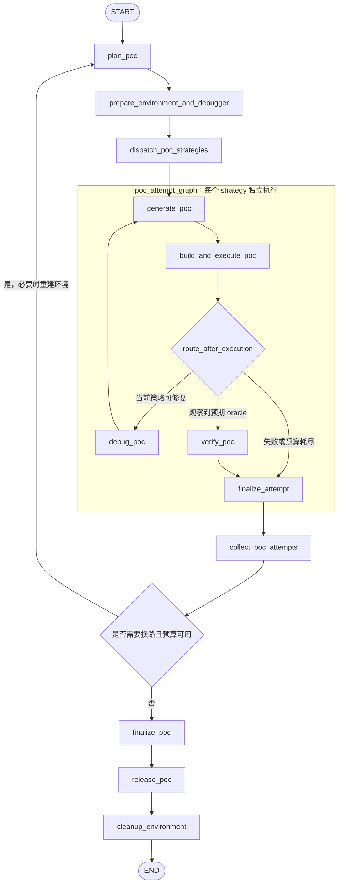
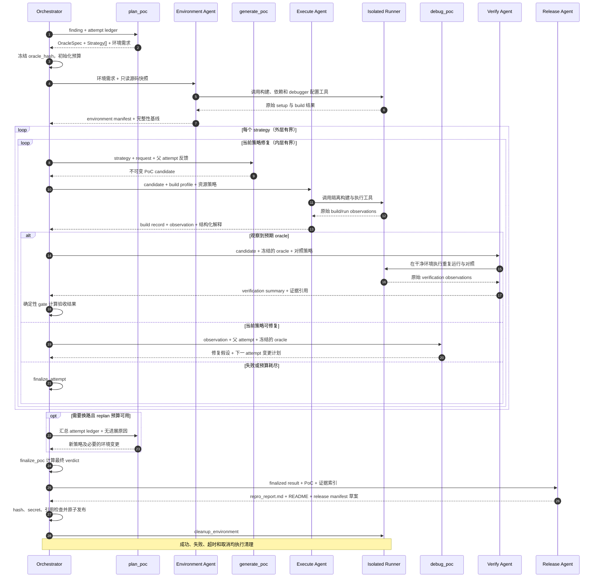

# PoC Gen 设计：有界非确定性搜索与确定性动态验证

## 1. 目标与边界

### 1.1 目标

对一个已经通过漏洞分析闭环的 finding，生成最小、可读、可复现、无害的 PoC，并回答：

- 能否从威胁模型允许的入口到达目标代码路径；
- 是否观察到该 finding 预先定义的安全 oracle；
- 结果是否绑定到确定的源码、构建和执行环境；
- 重复运行与对照实验是否支持同一结论；
- 未能复现时，具体卡在生成、构建、环境、可达性还是 oracle。

PoC Gen 是一层**动态验证增强**，不是重新进行漏洞资格裁决。

### 1.2 非目标

第一版明确不做：

- 稳定武器化 exploit、绕过利用缓解、隐蔽化或持久化；
- 为了触发崩溃而修改目标源码、二进制或运行时状态；
- 把任意 crash、非零退出、超时或 OOM 都当成漏洞复现；
- 用“没有复现”推翻已有 finding；
- 用模型自报的 `success=true` 代替执行证据；
- 在宿主环境直接运行不可信 PoC、fuzz driver 或目标构建脚本。

对于 `confirmed_primitive`，PoC 可以验证局部能力，但不能据此自动升级为 standalone vulnerability。

## 2. 节点划分

| 职责 | 实现节点 | 硬约束 |
| --- | --- | --- |
| 规划与策略切换 | `plan_poc` | 产出 oracle 草案、环境需求和有界策略集合，支持失败后换路 |
| 环境准备 | `prepare_environment_and_debugger` | Agent 主导构建、依赖和 debugger 配置；所有动作通过隔离工具执行 |
| PoC 生成 | `generate_poc` | 每次只实现一个明确策略，生成不可变 attempt，不覆盖上一轮产物 |
| PoC 调试 | `debug_poc` | 只能消费结构化 observation 并修改 PoC/harness，不能直接宣布成功或修改目标 |
| 动态实验 | `build_and_execute_poc` | Agent 选择并调用构建/运行工具；确定性 runner 执行、回收进程并保存原始观测 |
| 独立验收 | `verify_poc` | 独立 Agent 规划对照并调用复验工具；确定性 gate 根据全部证据计算 validated |
| 结果与生命周期 | `finalize_poc`、`release_poc`、`cleanup_environment` | Agent 生成复现报告与发布说明；发布与清理分离，清理覆盖所有退出路径 |

主要节点均采用 Agent Native 设计。Agent 负责理解目标、选择工具、处理环境差异和解释证据；确定性工具负责真实执行与安全限制；编排器负责预算、路由、最终 verdict 和发布门槛。所谓“用 Agent 包住”是让 Agent 驱动节点，不是让 Agent 绕过工具直接操作宿主，也不是让 Agent 自证成功。

## 3. 推荐 Workflow

### 3.1 顶层：按 finding 隔离

```text
START
  -> load_poc_requests
  -> dispatch_poc_findings
  -> N x poc_finding_graph
  -> summarize_poc_results
  -> END
```

默认只装载：

- `standalone_finding` 且通过现有 qualification gate 的结果；
- 已闭合的 `chain_finding`；
- 用户显式选择的其他结果。

`observation`、`rejected`、`inconclusive` 不默认进入。`confirmed_primitive` 只有显式选择时才进入，并使用局部 capability oracle。

loader 应同时支持当前 `log/subtask_res/` 和旧版 `log/review_res/`，前者优先；不能因为 README 中已有旧路径声明而只实现 legacy loader。

### 3.2 单个 finding：双层有界循环

流程图展示内层修复、外层换路以及独立验收和清理路径：



时序图进一步约束节点之间的数据流：生成器只提交候选，runner 只返回观测，最终结论由编排器根据验证证据定稿。



第一版可以串行执行策略，不必一开始就并发。状态契约稳定后，再复用现有 `Send(...)` 模式做 fan-out。每个 finding、strategy、attempt 和 verification 都必须有独立工作目录，避免并发覆盖。

### 3.3 两层循环分别解决什么问题

**内层 `generate_poc <-> debug_poc`**：修当前策略。

适用于编译错误、输入格式错误、缺失初始化、调用顺序错误、未到达入口、已到达但触发条件不完整等问题。每轮必须带上的新信息包括：

- 与父 attempt 的差异；
- 使用了哪一条 observation；
- 本轮要改变哪个触发条件；
- 预期新增什么可观测结果。

**外层 `collect_poc_attempts -> plan_poc`**：换触发策略。

适用于连续多轮没有新覆盖、失败签名重复、入口选择错误、需要换一种协议/配置/状态前置条件等情况。外层 planner 必须读取压缩后的 attempt ledger，而不是只看最后一次 stderr。

禁止把两层合并成一个由模型自由决定是否继续的环。所有回边都由编排器根据预算、失败类型和进展记录路由。

## 4. 节点契约

| 节点 | 类型 | 输入 | 输出与硬约束 |
| --- | --- | --- | --- |
| `plan_poc` | Agent | finding、代码证据、威胁模型、历史 attempt ledger | `oracle_spec` 草案、环境需求、最多 K 个互异策略；不能直接产出 validated 结论 |
| `prepare_environment_and_debugger` | Agent + 隔离环境工具 | 冻结的源码快照、环境需求、构建配置 | Agent 分析构建系统、选择依赖和配置只读 debugger；输出环境 manifest、工具链版本、build profile 和完整性基线 |
| `generate_poc` | Agent | 单个 strategy、request、可用接口、父 attempt 反馈 | PoC/harness/input、运行声明、策略实现说明；只写本 attempt 目录 |
| `build_and_execute_poc` | Agent + 确定性 runner | 不可变 attempt、构建 profile、资源策略 | Agent 在声明范围内选择并调用构建/运行工具；runner 保存原始 build record、exit/signal、sanitizer、backtrace、覆盖和 hash |
| `debug_poc` | Agent | 结构化 observation、最小必要日志、父 attempt、oracle | 修复假设和下一 attempt 变更计划；调试目标仍须通过 runner 执行 |
| `verify_poc` | 独立 Agent + 复验工具 + 确定性 gate | oracle-matched candidate、干净环境、对照策略 | Agent 规划并执行重复运行、正常输入/前置条件/修复版本对照，提交结构化摘要；gate 计算最终验收结果 |
| `finalize_attempt` | 确定性 | 单个策略的全部历史 | 不可变 attempt envelope；不得覆盖旧结果 |
| `finalize_poc` | 确定性 | 全部 attempt 与 verification | finding 级终态、最佳候选、失败分桶、未决缺口；原子写入 |
| `release_poc` | Agent + 确定性 publisher | finalized result、选中 PoC、证据索引 | Agent 生成复现报告、README 和 manifest 草案；publisher 做 hash、secret、绝对路径、状态和引用检查后原子发布 |
| `cleanup_environment` | 确定性 | 环境资源 ID | 停止进程树/VM/容器并回收 scratch；无论前序成败都执行，保留证据 |

#### Agent Native 的工具边界

- 环境准备必须由 Agent 驱动，因为构建系统识别、依赖选择、服务编排和 debugger 配置需要目标相关知识；但 Agent 只能通过隔离 setup/build/debug 工具改变环境，canonical 源码始终只读。
- 构建执行和复验必须由 Agent 包住，由 Agent 处理工具选择、参数适配和观测解释；实际构建、运行、资源回收、原始日志和 Oracle 匹配仍由确定性工具完成。
- 发布必须由 Agent 驱动，因为复现步骤、前提、证据解释和限制需要形成可读报告；Agent 不能修改 finalized verdict，也不能绕过 publisher 的机械检查。
- 所有 Agent 输出都分为“可编辑文档/计划”和“不可变执行证据”。自然语言总结不能覆盖 runner observation、Oracle 结果或确定性 verdict。

`plan_poc` 可以借助原生 subagent 做协议输入、API harness、状态构造、历史 PoC 移植等不同视角的发散，但这是实现增强，不是 MVP 前置条件。

## 5. 核心数据契约

### 5.1 PoCRequest

每个 request 至少包含：

```text
request_id / finding_id / finding_type / source_result_path
repo_id / revision / full_source_tree_hash
threat_model / attacker_entry / trigger_conditions
code_locations / call_path / violated_security_property
source_artifact_hashes / request_revision
```

`request_id` 由编排器计算。模型生成的标题不能作为身份依据。多仓库和 chain finding 必须保留 repository-qualified ID 与完整攻击路径。

### 5.2 OracleSpec：先定义成功，再生成 PoC

#### 5.2.1 设计理念

Oracle 是“这次执行是否观察到目标安全性质被违反”的判定机制，不是数据库，也不是某个具体的 sanitizer、debugger 或 Agent。它位于原始观测与最终结论之间：

```text
PoC/input -> 隔离执行 -> 原始观测 -> Oracle 匹配 -> 复验与对照 -> PoCVerdict
```

ASan、TSan、debugger、覆盖率工具和业务状态采集器负责产生观测；Oracle 负责解释观测。Agent 可以帮助选择规则、配置采集工具和解释语义证据，但 Agent 自报的 `success=true` 不是 Oracle。

OracleSpec 是这份判定标准的机器可读契约，核心目的有四个：

1. **把目标从“制造 crash”改为“验证特定安全性质”**。任意非零退出、SIGSEGV、timeout 或 OOM 都不自动构成复现。
2. **让生成和调试有明确方向**。调试反馈应说明缺少哪条 reachability、哪个 expected 条件或哪个对照，而不只是粘贴 stderr。
3. **防止移动球门**。首个 attempt 前冻结标准，生成器不能在失败后把更弱的条件改写成成功。
4. **让结论可重放、可审计**。每次 Oracle 匹配都能追溯到规则版本、执行环境、原始观测和对照结果。

必须区分三个层次：

| 层次 | 示例 | 能证明什么 |
| --- | --- | --- |
| Observation | exit code、signal、ASan report、backtrace、响应对象、耗时 | 本次运行实际发生了什么 |
| Oracle match | 目标 ASan 签名匹配、跨租户不变量被违反 | 本次运行是否满足预定义规则 |
| Final verdict | `validated`、`reproduced_unstable`、`inconclusive` | 全部复验、对照、稳定性和证据门槛是否通过 |

单次 `oracle_match=true` 不等于 finding 级 `validated`。

#### 5.2.2 字段契约

建议基础结构：

```json
{
  "kind": "sanitizer|signal|exit_code|output|state_invariant|plugin",
  "expected": {},
  "reachability": {"required_markers": []},
  "controls": [],
  "stability": {"runs": 5, "min_matches": 3},
  "profile": "plain|asan|ubsan|tsan|semantic"
}
```

| 字段 | 职责 | 关键设计要求 |
| --- | --- | --- |
| `kind` | 选择判定器及 expected 的内部 schema | `signal` 和 `exit_code` 通常较弱，不能脱离路径与对照单独使用 |
| `expected` | 描述目标漏洞的精确现象 | 可包含错误类别、关键栈帧、匹配模式、安全不变量或插件参数 |
| `reachability` | 描述必须到达的入口、函数、协议状态或业务阶段 | marker 应由 runner/debugger/覆盖率工具采集，不能由 PoC 自报 |
| `controls` | 声明正常输入、缺失前置条件、修复版本等对照 | 每项包含 `kind`、`required` 和可选参数；跳过 required control 会阻止 validated |
| `stability` | 声明重复运行次数与最低匹配次数 | `1 <= min_matches <= runs`；阈值必须在实验前确定 |
| `profile` | 绑定判定适用的构建和观测环境 | ASan 证据不能静默套用到 plain binary，semantic profile 必须记录状态采集方式 |

`expected.match` 可定义为 `all`、`any` 或更具体的插件匹配模式。默认建议 `all`，避免只满足一个弱条件就匹配。调用栈匹配应优先使用稳定的错误类别和关键符号，不要求完整栈逐字一致，以免编译器内联和符号化差异造成误判。

每个 OracleSpec 还应有编排器计算的 `oracle_hash`。hash 输入应使用 canonical JSON，覆盖规则本身及其插件身份，但不包含本轮运行结果。

#### 5.2.3 Case A：ASan 堆越界

目标性质：攻击者输入经过 `parse_packet -> copy_option` 后造成堆缓冲区越界，而不是任意位置崩溃。

```json
{
  "kind": "sanitizer",
  "expected": {
    "sanitizer": "AddressSanitizer",
    "error": "heap-buffer-overflow",
    "top_symbols": ["copy_option", "parse_packet"],
    "match": "all"
  },
  "reachability": {
    "required_markers": ["parse_packet", "copy_option"]
  },
  "controls": [
    {"kind": "benign_input", "required": true},
    {"kind": "patched_build", "required": false}
  ],
  "stability": {"runs": 5, "min_matches": 3},
  "profile": "asan"
}
```

判定要点：

- `heap-buffer-overflow`、关键符号和 required markers 必须同时满足；
- 正常输入不能触发同一个精确 Oracle；
- 有 patched build 时应运行同一 PoC，并记录是否仍触发同一签名；
- 结论绑定 ASan profile、实际 binary hash 和 sanitizer runtime，而不是泛泛写成“目标必然崩溃”。

#### 5.2.4 Case B：跨租户读取

目标性质：已认证租户 A 能读取租户 B 的资源。HTTP 200 本身不足以证明漏洞，响应可能为空、脱敏或来自缓存。

```json
{
  "kind": "state_invariant",
  "expected": {
    "invariant": "response.resource.owner_tenant == request.auth_tenant",
    "violation": "cross_tenant_read_observed",
    "required_fields": ["response.resource.id", "response.resource.owner_tenant"],
    "match": "all"
  },
  "reachability": {
    "required_markers": ["authenticated_request", "resource_read"]
  },
  "controls": [
    {"kind": "same_tenant_input", "required": true},
    {"kind": "unauthenticated_request", "required": true}
  ],
  "stability": {"runs": 3, "min_matches": 3},
  "profile": "semantic"
}
```

判定要点：

- 状态采集器必须证明响应中的资源确实属于另一租户；
- 同租户正常读取用于验证测试环境和资源存在性，未认证请求不能绕过访问控制；
- 如果语义规则由 Agent 辅助解释，结构化资源身份、原始响应和解释结果都必须保留，不能只保留“看起来越权”的文本结论。

#### 5.2.5 Case C：算法复杂度或资源型 DoS

目标性质：恶意输入导致异常资源消耗。普通 runner timeout 可能是环境抖动，必须同时设置绝对阈值、相对基线和正常输入对照。

```json
{
  "kind": "plugin",
  "expected": {
    "plugin": "latency_ratio_oracle",
    "plugin_version": "1.0",
    "operation": "parse_packet",
    "min_absolute_milliseconds": 2000,
    "min_ratio_to_baseline": 20,
    "match": "all"
  },
  "reachability": {
    "required_markers": ["parse_packet", "vulnerable_loop"]
  },
  "controls": [
    {"kind": "benign_input", "required": true},
    {"kind": "resource_limit_environment", "required": true}
  ],
  "stability": {"runs": 3, "min_matches": 3},
  "profile": "plain"
}
```

判定要点：

- 恶意输入必须超过绝对耗时阈值，并相对正常基线超过指定倍数；
- 必须排除 runner 自身 timeout、宿主机负载波动和资源限制配置错误；
- 对内存型 DoS 可换成内存阈值插件，但 runner OOM 与目标预期 OOM 必须分开记录；
- 插件的可执行文件或源码 hash、版本和参数都进入证据链。

#### 5.2.6 Case D：竞态与不稳定复现

目标性质：并发操作触发 ThreadSanitizer 可识别的 data race。竞态可以真实存在但复现概率较低，因此稳定性标准不能简单要求每次成功。

```json
{
  "kind": "sanitizer",
  "expected": {
    "sanitizer": "ThreadSanitizer",
    "error": "data race",
    "top_symbols": ["update_shared_state", "worker_thread"],
    "match": "all"
  },
  "reachability": {
    "required_markers": ["worker_thread", "update_shared_state"]
  },
  "controls": [
    {"kind": "serialized_execution", "required": true},
    {"kind": "patched_build", "required": false}
  ],
  "stability": {"runs": 10, "min_matches": 2},
  "profile": "tsan"
}
```

判定要点：

- 串行执行不应出现同一竞态签名；
- 10 次中至少 2 次匹配只是本例的预注册阈值，不是全局默认值；
- 观察到目标签名但未达到阈值的候选可保留为 `reproduced_unstable`，不能隐藏，也不能直接升格为 validated；
- debugger 会改变时序，最终复验必须包含无 debugger 的运行。

#### 5.2.7 匹配、对照与最终验收

单次运行建议按以下顺序判定：

```text
runner_status == completed_or_expected_terminal
AND required_reachability_observed
AND expected_rule_matched
AND observation_identity_complete
-> oracle_match = true
```

`oracle_match=true` 后仍需独立 verify：干净环境重跑、适用对照、稳定性和反证检查全部通过，才能进入 `validated`。环境失败时不能进行“未匹配”的业务判定，应归为 `environment_failed` 或 `inconclusive`。

control 的 `required=false` 表示允许在具有明确理由时跳过，不表示默认通过；所有跳过都必须记录 `skip_reason`。required control 缺失、执行失败或结果冲突时，不得发布 validated。

#### 5.2.8 不可变性、插件与语义 Agent

- 首个 attempt 前冻结 `oracle_hash`，所有 generate/debug/execute/verify 都引用同一 hash。
- 修改 Oracle 必须创建新的 `request_revision`，记录变更原因、前后 diff 和独立复核；旧 run 不能沿用到新标准。
- 自定义插件必须声明版本、hash、输入输出 schema 和资源限制；插件异常应输出 unknown/inconclusive，不能默认不匹配或匹配。
- `verify_poc` Agent 可以规划对照、调用语义插件和解释证据，但应与 generate/debug 使用独立会话，避免沿用生成者的结论锚定。
- 最终 mechanical gate 必须检查原始观测、规则匹配、对照、稳定性和 hash 是否齐全，不能由任何 Agent 直接用自然语言覆盖。

### 5.3 PoCStrategy

```text
strategy_id / parent_strategy_id / kind / objective
entry_point / required_state / environment_requirements
expected_path / expected_oracle / novelty_key
rank / status / pruning_or_stop_reason
```

`novelty_key` 用于发现“换了代码但没换策略”。例如仅修改字节值、变量名或等待时间，不应被计作全新策略。

### 5.4 PoCAttempt 与 ExecutionObservation

attempt 至少记录：

```text
attempt_id / finding_id / strategy_id / parent_attempt_id
request_revision / oracle_hash / generation_round
poc_artifact_hashes / build_manifest_hash / environment_manifest_hash
change_from_parent / generation_output / debug_hypothesis
run_ids / status / failure_bucket / progress_markers
```

每次 execution 独立记录：

```text
run_id / attempt_id / verification_id
argv / cwd / stdin_or_input_refs / env_allowlist
source_hash / target_binary_hash / dependency_hashes
image_digest / toolchain / flags / sanitizer_options
started_at / duration / exit_code / signal / timeout / resource_usage
stdout_ref / stderr_ref / sanitizer_ref / backtrace_ref
oracle_match / matched_rule / unexpected_signals / runner_status
```

所有 ID 和 hash 由编排器生成。attempt 目录只追加，不覆盖；重试前清除的是“本次调用临时输出”，不能删除历史 attempt 的证据。

### 5.5 PoCVerdict

finding 级终态建议为：

| 终态 | 含义 |
| --- | --- |
| `validated` | 预期 oracle、身份绑定、干净复验、对照与稳定性策略全部通过 |
| `reproduced_unstable` | 确实观察到预期 oracle，但未达到预先声明的稳定性或复验要求 |
| `not_reproduced` | 有效实验已执行，但未观察到预期 oracle；不代表漏洞不存在 |
| `environment_failed` | 无法建立可信构建/运行环境，不能据此评价 PoC 或 finding |
| `inconclusive` | 证据不完整、oracle 无法判定、策略/时间/成本预算耗尽 |
| `unsupported` | 当前没有适合该目标的安全执行后端或 oracle 插件 |
| `cancelled` | 用户或上层流程取消，已保留部分证据并完成清理 |

单次 run 另用 `expected_oracle`、`no_oracle`、`unexpected_crash`、`build_failed`、`setup_failed`、`runner_failed`、`timeout`、`oom` 等细分类，不能与 finding 级终态混用。对于 DoS 类 finding，timeout/OOM 是否为目标效果只能由预先定义的 oracle 和资源阈值决定。

## 6. 路由、进展与停止条件

### 6.1 路由矩阵

| 执行结果 | 下一动作 | 是否消耗 debug round |
| --- | --- | --- |
| Agent 输出 schema 不合法 | 重试同次生成调用，沿用现有 fresh artifact 校验思路 | 否 |
| PoC/harness 自身编译错误 | `debug_poc` | 是 |
| 目标环境/依赖/runner 故障 | 有界环境修复或 `environment_failed` | 否 |
| 未到达攻击入口 | `debug_poc`；重复无进展后外层换路 | 是 |
| 到达入口但未满足触发条件 | `debug_poc`，反馈覆盖和状态差异 | 是 |
| 非预期 crash 或正常输入也 crash | 检查环境/oracle；不得进入 validated | 视原因而定 |
| 观察到预期 oracle | `verify_poc`，不是直接发布 | 否 |
| 复验失败或对照冲突 | 降级为 unstable/inconclusive，或按明确原因继续调试 | 按路由策略 |
| 达到预算仍无结论 | `finalize_poc(inconclusive)` | 停止 |

### 6.2 进展不能只用“是否 crash”衡量

每轮提取结构化进展标记：

- 新增入口、函数、基本块或协议状态覆盖；
- 构建阶段从配置/编译/链接向运行推进；
- 与目标 sink 的距离或调用路径匹配增加；
- sanitizer/backtrace 从无关错误转为目标签名；
- 必要前置状态从未知变为已满足。

若连续 N 轮没有新增 marker，或 `failure_signature + coverage_signature + environment_hash` 重复，则禁止继续同策略微调，必须换路或终止。

### 6.3 预算必须分维度

至少分别限制：

- 每个 finding 的 strategy 数；
- 每个 strategy 的 debug round；
- 每个 finding 的 replan round；
- 环境修复次数；
- 单次生成、构建、运行、调试和验证 timeout；
- 总 wall-clock、并发、CPU、内存、PID、磁盘和日志量；
- 后续接入 workflow 级 token/cost budget。

格式重试、业务 debug、环境修复和复验次数必须独立计数，不能用一个 `iteration` 混算。

## 7. 禁止修改目标与允许行为的精确定义

“禁止 patch 源码、禁止 patch 产物”应落实为可执行约束，而不只是 prompt。

### 7.1 强制禁止

- 修改 canonical 源码、子模块、依赖源码或由上游提供的测试数据；
- 对目标 binary/library 做二进制补丁、hot patch 或运行后替换；
- 用 debugger 修改 PC、寄存器、内存、返回值，跳过指令或强制走到 crash；
- 通过 `LD_PRELOAD`、hook、mock、stub 等改变目标关键安全行为来制造 oracle；
- 在失败后改写 oracle、删除反证或复用旧日志冒充新执行；
- 将宿主机凭据、无关环境变量或绝对私有路径带入 PoC 包。

### 7.2 明确允许

- 修改本 attempt 自己生成的 PoC、输入、harness 和运行脚本；
- 在源码保持只读的前提下，使用不同编译参数做独立 plain/ASan/UBSan/TSan 构建；
- 使用只读 breakpoint、watchpoint、backtrace、寄存器/内存读取和符号化；
- 使用符合威胁模型且完整声明的配置、协议序列、账号、初始状态和正常依赖；
- 将已有 fuzz driver 改造成最小 repro，但所有新增文件都属于 PoC 侧。

instrumented build 不是“patch 源码”，但它是不同 build profile。结果必须明确标注实际 profile，不能把 ASan 构建上的观察静默写成对另一二进制的验证。

### 7.3 完整性检查

- 构建前和每次运行后校验源码树未漂移；
- Git 场景除 HEAD/status 外，还要记录能覆盖 dirty 工作树内容的完整 tree hash；
- 对实际执行的 binary、关键 library、PoC、输入和 oracle 插件记录 SHA-256；
- 一个 verdict 只能引用同一 request revision 下、证据链完整的 run，不得跨环境拼接“成功”。

## 8. 验证门槛与对照实验

### 8.1 validated 硬门槛

```text
source_integrity_ok
AND no_forbidden_target_mutation
AND poc_and_build_identity_complete
AND expected_oracle_observed
AND execution_evidence_complete
AND fresh_environment_verification_passed
AND stability_policy_passed
AND applicable_controls_passed
AND no_unresolved_counterevidence
```

门槛通过前，Agent 可以提交 candidate，但不能发布 `validated`。

### 8.2 对照实验

按 finding 适用性选择：

1. **正常输入对照**：不应触发同一个精确 oracle。
2. **缺失攻击前置条件对照**：未认证、缺少状态或缺少能力时不应触发。
3. **patched/fixed 版本对照**：有可靠修复版本时，同一 PoC 不应触发同一 oracle。
4. **重复运行**：验证确定性或记录 flaky 分布。
5. **无 debugger 运行**：避免把 ptrace、断点和时序扰动当成触发条件。

对照缺失必须记录原因，不能默认视为通过。patched control 冲突意味着当前 PoC/oracle 不能 validated；它不会自动推翻原 finding，仍需回到漏洞分析层解释。

竞态和时序类 PoC 可以天然不稳定，因此稳定性阈值应由 oracle 预先声明。未达到阈值但有真实预期观察时保留为 `reproduced_unstable`，不能隐藏，也不能升格。

### 8.3 最小化

最小化是后处理，不是首要目标。只有候选已 validated 后才可做；每次最小化必须保留 lineage，并对最小结果重新执行完整 verify。不能拿最小化前的证据给最小化后的 PoC 背书。

## 9. 执行隔离与环境生命周期

现有 Agent 的 `workspace-write` 主要约束工作区写入，**不是不可信代码执行边界**。PoC runner 必须独立建设：

- 默认非 root、只读源码挂载、独立 build/scratch/output；
- 默认运行期断网；依赖获取只在 setup 阶段按 allowlist 和锁文件执行；
- 不继承宿主 secret，不挂载 Docker socket，不使用 privileged、host PID/IPC 或危险 capabilities；
- 限制 CPU、内存、PID、磁盘、单文件和日志大小；
- timeout 后终止整个进程树，处理 fork、后台进程和残留 VM；
- 构建脚本和 PoC 一样视为不可信代码，构建阶段也必须隔离；
- 后端不可用时 fail closed，不能自动退回宿主 `subprocess.run(...)`。

建议定义统一后端接口：

```text
prepare(request) -> environment_manifest
build(attempt) -> build_record
run(attempt, profile) -> execution_observation
debug(attempt, read_only_script) -> execution_observation
snapshot() / reset() / cleanup()
```

普通用户态服务优先 container/namespace；内核、KVM、驱动和跨 VM 边界目标使用 VM 后端。不能把容器假设直接套到这些目标。

`cleanup_environment` 必须位于类似 `finally` 的保障路径。清理失败时保留 finalized result 和 `cleanup_status=cleanup_failed` 供告警，不能因清理失败删除证据，也不能把环境状态伪报为已释放。

## 10. 产物、发布与恢复

建议布局：

```text
<workspace>/
  poc/<finding-id>/
    request.json
    plan.json
    environment.json
    attempts/<attempt-id>/
      generation.json
      poc/
      build.json
      runs/<run-id>/
      debug/
    verification/<verification-id>/
  log/poc_res/<finding-id>.json
  deliverables/poc/<finding-id>/
    manifest.json
    README.md
    repro_report.md
    poc/
    inputs/
    evidence/
```

要求：

- JSON 使用 temp file + atomic replace；
- canonical result 只引用 manifest 中发布的 run，目录里存在旧 crash log 不等于它是 active evidence；
- release 包只包含最小必要代码、输入、运行说明和裁剪后的证据，core dump 默认不打包；
- `release_poc` Agent 必须生成 `README.md` 和 `repro_report.md`；前者提供快速运行入口，后者提供完整复现报告，失败或部分结果同样需要报告；
- 复现报告至少包含 finding 摘要、源码与环境身份、构建步骤、逐条复现命令、OracleSpec、预期与实际观测、对照与稳定性结果、最终状态、限制和证据链接；
- 报告中的每个关键结论都必须引用 run/verification ID 或 artifact hash，且报告状态必须与 finalized verdict 一致；
- publisher 在发布前校验 hash、引用、secret、绝对路径、宿主用户信息、报告必备章节和状态一致性；
- partial/unstable/not_reproduced 也可以保留审计产物，但包名、manifest 和报告必须明确状态，不能伪装成 validated PoC；
- 重跑使用新的 run/selected-run 目录，只有显式提升流程才能替换 canonical 结果。

恢复应以 `finding_id + request_revision + attempt_id` 为边界。环境 handle、锁、回调和凭据不能进入可序列化 graph state，只保存资源 ID 与可恢复 manifest。

## 11. 与现有 ZeroMDASH 的集成

### 11.1 模块位置

当前实现位于 `zeromdash/poc_gen/`，通过主 graph 的可选 `poc_gen` 节点接入：

```text
summary -> polish_report -> poc_gen（可选）-> END
```

模块包含 finding loader、OracleSpec/匹配、Agent 调用、attempt 管理、复验、报告和 publisher。显式 only-gen 模式从既有 workspace 恢复状态并只运行该节点，不重跑扫描。

`poc_gen` 是确定性编排节点，不是 Agent runtime 配置项。`plan_poc`、`prepare_environment_and_debugger`、`generate_poc`、`build_and_execute_poc`、`debug_poc`、`verify_poc`、`release_poc` 都注册在 `DEFAULT_BACKENDS` 中，分别支持 runtime/config/provider/model/env/focus/fallback、启动健康检查和独立 headless 调用。

七个阶段的 prompt 模板集中在 `zeromdash/prompts.py` 的 `POC_*` 常量中。finding、OracleSpec、strategy、generation、observation 和 release evidence 均先物化为 workspace 内的 JSON 文件，prompt 只传文件路径和少量预算参数，避免把大型结构化上下文重复内联到 Agent 调用中。

### 11.2 可复用能力

优先复用或抽取公共实现：

- LangGraph nested graph、`Send(...)` 和 per-child scratch state；
- Agent 调用、格式重试、fresh artifact、结构化 validator 和显式 runtime fallback；
- 原子 JSON、SourceRef、artifact hash、manifest 发布边界；
- selected-run 隔离、终态 envelope、完整 history 和 runtime recovery；
- Langfuse 节点 tracing 与 `agent_commands.jsonl` 审计。

当前 PoC 调用集中在 `poc_gen.service` 中复用 `_invoke_with_output_retry`，避免各阶段分别实现重试和恢复；后续应把该 adapter 提升为稳定的公共接口。

### 11.3 不反向污染漏洞结论

PoC 结果通过 `poc_results` 和 `log/poc_res/` 关联到 finding/report group，不原地改写既有 finding JSON：

- `validated` 可增加动态证据并缩小 `validation_gaps`；
- `not_reproduced` 只记录本次覆盖与限制，不自动降低漏洞资格；
- `environment_failed` 不等于 `not_reproduced`；
- CVSS 仍基于已确认的最终安全影响，不因 PoC 稳定性机械加分或减分；
- 发现代码级反证时，应创建新的分析反馈任务，而不是由 runner 或 PoC Agent 擅自改 critic verdict。

### 11.4 建议配置

以下数值只是保守初始值，需按目标类型校准：

```yaml
poc:
  enabled: false
  backend: agent_sandbox
  max_findings: 8
  max_strategies_per_round: 3
  max_debug_rounds_per_strategy: 4
  max_no_progress_rounds: 2
  verification_runs: 3
  verification_min_matches: 2

node:
  plan_poc:
    runtime: codex
  prepare_environment_and_debugger:
    runtime: codex
  generate_poc:
    runtime: codex
  build_and_execute_poc:
    runtime: codex
  debug_poc:
    runtime: codex
  verify_poc:
    runtime: codex
  release_poc:
    runtime: codex
```

`enabled=false` 默认关闭高成本动态执行。普通扫描只有显式设为 true 才在报告后运行 PoC；`--till-node summary` 总是优先停止。两个 only-gen 模式会强制启用，不要求修改原配置。

当前 `agent_sandbox` 后端由所选 Agent runtime 的沙箱执行构建和运行，编排器校验结构化 observation、源码树 hash、Oracle 和复验结果。它不等于独立的容器/VM 不可信代码隔离后端；容器、VM、进程树资源控制和跨后端恢复仍是后续工作，不能把当前结果误解为已经完成这些隔离保证。

### 11.5 CLI 入口

```bash
# 扫描结束后继续生成：agent-config 中设置 poc.enabled=true
zeromdash --target ./my-project --agent-config ./agents.yaml

# 只跑到 summary，即使 poc.enabled=true 也不生成 PoC
zeromdash --target ./my-project --agent-config ./agents.yaml --till-node summary

# 从 workspace 为全部合格 finding 生成
zeromdash --only-gen-pocs .zeromdash/workspace_for_my-project --agent-config ./agents.yaml

# 只生成一个 finding；支持 report group ID、subtask ID 或 chain ID
zeromdash --only-gen-poc .zeromdash/workspace_for_my-project:VULN-001 --agent-config ./agents.yaml
```

两个 workspace 参数都支持绝对路径和相对路径。单 finding 参数按最后一个冒号拆分 workspace 与 ID。

## 12. 可观测性与审计

每个 finding 至少汇总：

- 尝试的 strategy/attempt/run 数和各阶段耗时；
- 每轮失败 bucket、进展 marker、换路原因和预算消耗；
- 每个 Agent invocation 的 runtime/config/model、输出校验和 fallback；
- 每次目标执行的环境、binary、PoC、oracle 和 observation hash；
- validated/unstable/not_reproduced/environment_failed/inconclusive 的最终分布；
- cleanup 状态与资源残留。

日志应支持回答“为什么继续”“为什么换路”“为什么停止”“凭什么 validated”，而不只是保存最后一次模型回复。

## 13. 测试与验收

### 13.1 Workflow 单测

- 合法/非法 Agent 输出与 stale artifact 不消耗错误的预算维度；
- 内层 debug、外层 replan、环境修复均能到达确定上限；
- 重复 failure signature 和无进展时不会无限微调；
- 多 attempt 并发不覆盖目录、history 或 canonical result；
- cancel/timeout/build failure/runner failure 都进入 cleanup；
- selected run 不覆盖 canonical PoC 结果。

### 13.2 Oracle 与 verdict 单测

- 任意非零退出、无关 SIGSEGV、runner crash、普通 timeout 不会被误判 validated；
- 正常输入或 fixed build 触发同一 oracle 时候选不能 validated；
- ASan profile 的证据不会绑定到 plain binary；
- 缺少 hash、backtrace、control 或稳定性证据时只能降级；
- not_reproduced 不改变原 finding 的 qualification；
- 修改 oracle 会产生新 request revision，旧验证结果不能复用。

### 13.3 隔离与完整性测试

- 源码只读，构建后源码 tree hash 不变；
- PoC 不能访问宿主 secret、写挂载外目录或访问未允许网络；
- fork/后台进程、OOM、磁盘和日志爆炸均被限制并回收；
- binary patch、debugger 状态修改和 forbidden hook 会被策略拒绝；
- 环境、执行和复验 Agent 不能绕过隔离工具直接操作宿主，也不能篡改原始 observation；
- verify Agent 使用独立会话，release Agent 不能修改 finalized verdict；
- 后端不可用时不会回退宿主执行。

### 13.4 最小端到端样例

至少准备四类固定样例：

1. ASan 可稳定检测的堆越界；
2. 需要多步协议状态才能到达的逻辑漏洞；
3. 正常输入也崩溃的坏环境，必须被对照拦截；
4. 无法构建或 runner 故障，必须输出 environment_failed 而非 not_reproduced。

后续再增加竞态、patched control、VM/KVM 和 chain finding 样例。每类样例都要校验 Agent 生成的复现报告包含必备章节、可执行命令和证据引用，且报告状态与 finalized verdict 一致。

## 14. 分阶段落地

### P0：可信执行与契约骨架

- 实现 request/oracle/attempt/observation/verdict schema；
- 实现 finding loader、只读源码快照、完整身份绑定；
- 实现一种隔离 runner、资源限制和 guaranteed cleanup；
- 用人工写好的 PoC 打通 execute -> oracle -> verify -> finalize。

这一阶段先证明“判定可信”，不要先做多 Agent 发散。

### P1：单 finding、单策略生成调试闭环

- 实现 Agent 驱动的环境准备及 plan/generate/debug/execute 内层有界循环；
- 加入结构化进展、失败分桶和预算；
- 实现独立 Verify Agent、确定性验收 gate、对照实验和最小 release package；
- 实现 Release Agent，生成 README 与完整 `repro_report.md`。

### P2：策略发散与工程化

- 增加多策略规划、外层 replan 和 novelty/no-progress 检测；
- 在目录与环境隔离可靠后增加 `Send(...)` 并发；
- 增加 restore、selected-run、token/cost 统计和更多执行后端。

### P3：质量增强

- PoC 最小化并重新完整验证；
- semantic oracle 插件、chain/primitive 专项验证；
- summary/report group 展示动态验证状态与证据链接；
- 基于真实 case 校准默认预算、稳定性策略和策略排序。

## 15. MVP 完成定义

MVP 不以“Agent 能写出一段 PoC”为完成标准，而应同时满足：

- 一个 confirmed finding 能经过 Agent 驱动的 plan -> prepare -> generate -> execute -> debug -> verify 有界闭环；
- 所有目标执行都在隔离后端，源码和目标产物不可修改，Agent 不能绕过执行工具；
- validated 只能由确定性 gate 根据新鲜执行证据产生；
- 失败、无进展、预算耗尽和取消都能终止并完成清理；
- 产物能解释每次换路与最终状态，并可在干净环境按 README 重跑；Release Agent 输出的复现报告包含完整步骤、证据和限制；
- not_reproduced/environment_failed/inconclusive 不会被误报为漏洞不存在或 PoC 成功。

最终架构以 planner 扩展发散、以 runner/oracle 完成收敛、以双层预算环控制非确定性，并以独立发布和清理完成生命周期。
