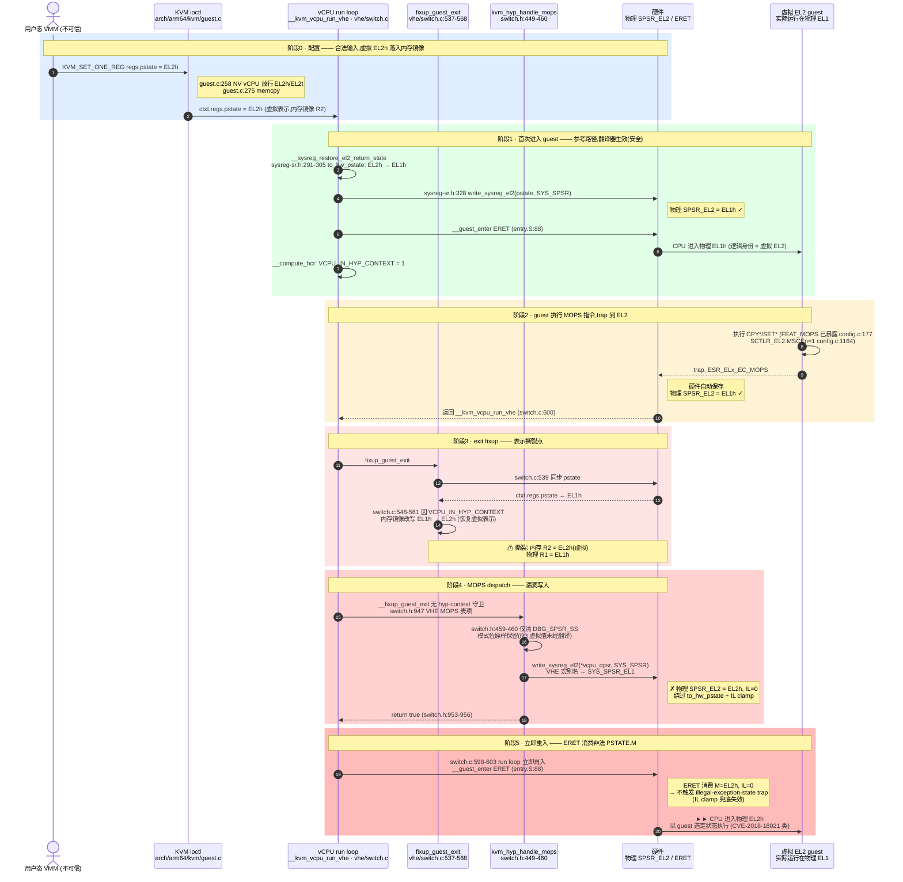
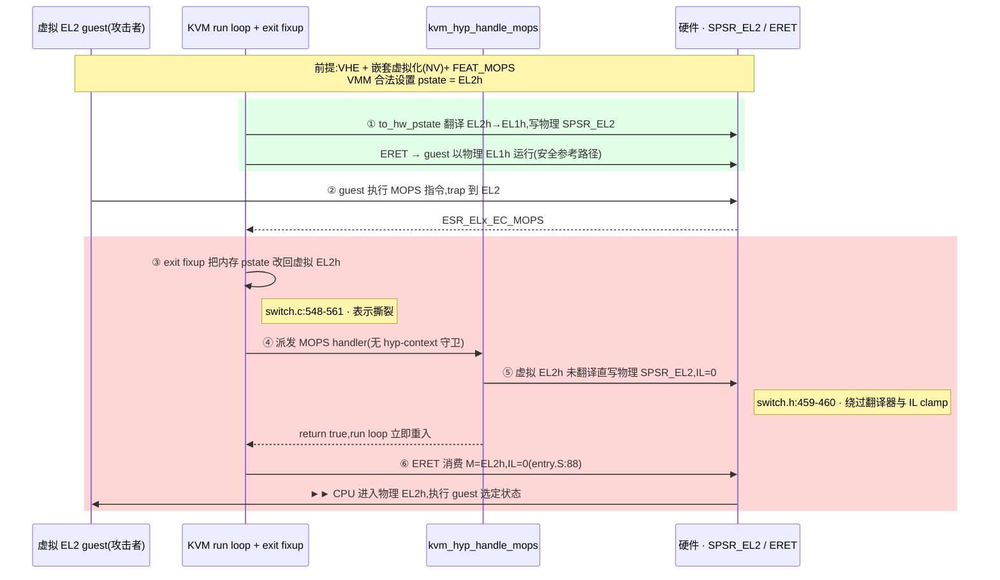

# 案例:KVM arm64 VHE MOPS 重入写入虚拟 EL2 PSTATE.M 漏洞(CVE-2026-64555)

- **案例编号**:CVE-2026-64555
- **发现方式**:ZeroMDASH 自动分析,subtask `vuln-034`
- **来源 workspace**:`.zeromdash/workspace_for_kvm-arm64__20260702T045342`
  (`final_state.json` → `vuln_candidates[33]`)
- **复核结论**:critic verdict `confirm`,severity **high**,confidence **0.82**(2 轮迭代)
- **Bug class**:CVE-2018-18021 同类 —— 非法 PSTATE.M 到达 ERET sink
- **影响面**:VHE + 嵌套虚拟化(NV)+ FEAT_MOPS 硬件;nVHE 天然免疫

---

## 1. 漏洞概述

一句话:同一次 exit fixup 里,`fixup_guest_exit` 先把内存中的 vCPU pstate 镜像
从物理 EL1h 改回**虚拟** EL2h 表示(`arch/arm64/kvm/hyp/vhe/switch.c:548-561`),
随后同一趟 fixup 派发的 `kvm_hyp_handle_mops` 假设该镜像已是物理表示,未经
`to_hw_pstate()` 翻译、也未施加 IL clamp,直接写入物理 SPSR_EL2
(`arch/arm64/kvm/hyp/include/hyp/switch.h:459-460`);run loop 立即重入,
`__guest_enter` 的 ERET(`arch/arm64/kvm/hyp/entry.S:88`)带着 `M=EL2h, IL=0`
进入物理 EL2h,以 guest 选定的状态执行。

KVM 对"guest 运行在物理 EL2"的唯一兜底是 `to_hw_pstate()` 里的
`EL2h|PSR_IL_BIT` clamp(`arch/arm64/kvm/hyp/include/hyp/sysreg-sr.h:313-325`,
注释自述其目的就是让 ERET 到 EL2+ 立即触发 illegal-exception-state trap)。
MOPS 路径写入 EL2h 且 **IL=0**,ERET 合法通过,兜底失效。

### 根因

producer/consumer 对"内存 pstate 镜像当前是哪种表示"的假设相反:

- **producer**(`fixup_guest_exit` 的 VCPU_IN_HYP_CONTEXT 分支)在同一趟
  fixup 中先把镜像恢复为**虚拟表示**(EL1h→EL2h),这是给 NV 抽象层看的;
- **consumer**(`kvm_hyp_handle_mops`)把镜像当作**物理表示**原样写回硬件。

中间没有任何翻译器或 clamp,违反 sink 的不变量(见 §4.5)。

---

## 2. 触发时序图

图中绿色(阶段 1)是安全的参考路径,红色三段(阶段 3-5)是漏洞本体:
表示撕裂 → 未翻译写入 → ERET 消费。

---

## 3. 触发条件(可达性前提)

guest 可自主触发,无需竞争条件:

1. VHE 宿主 + NV vCPU(`vcpu_has_nv`,NV 仅 VHE 支持);
2. FEAT_MOPS 对 NV guest 暴露(`arch/arm64/kvm/config.c:177`);
3. `SCTLR_EL2.MSCEn` 已配置(`arch/arm64/kvm/config.c:1164`);
4. vCPU 处于非 InHost hyp context(`VCPU_IN_HYP_CONTEXT` 置位,即虚拟 EL2
   guest 被翻译到物理 EL1 运行的窗口)。

nVHE 免疫:`nvhe/switch.c:226-255` 的 fixup 没有 VCPU_IN_HYP_CONTEXT 转换,
且无 NV 时 `is_hyp_ctxt` 恒 false,MOPS 路径只见 EL1 guest(幂等,安全)。

---

## 4. 威胁建模(按 ZeroMDASH 框架,`zeromdash/prompts.py:247-265`)

### 4.1 Entrypoints + Trust Boundary

| Entrypoint | 不可信输入 | 位置 |
|---|---|---|
| `KVM_SET_ONE_REG` (ioctl) | regs.pstate = EL2h/EL2t(NV vCPU 合法放行) | `arch/arm64/kvm/guest.c:242-275`;`Documentation/virt/kvm/api.rst:2333` |
| guest 执行 MOPS 指令 (CPY*/SET*) | trap 本身及触发时机(hyp-context 窗口内) | trap 配置 `config.c:177`、`config.c:1164` |
| 嵌套虚拟化 sysreg/ERET 状态 | guest SPSR_EL2 slot、虚拟 ERET | `arch/arm64/kvm/emulate-nested.c:2733-2804`(已消毒,非漏洞路径) |

**关键信任边界**:guest(虚拟 EL2,实际跑在物理 EL1)→ host hyp(物理 EL2)。
guest 可影响的异常返回状态(pstate 模式位)穿过该边界进入 EL2 的
guest-entry 路径。用户态→内核 ioctl 边界只是预置条件(pstate=EL2h 是合法
输入);漏洞本质发生在 guest→EL2 边界上,**状态表示被错误信任**。

### 4.2 解释器/状态机热点

- **vCPU run loop 状态机** —— `__kvm_vcpu_run_vhe`(`vhe/switch.c:598-603`):
  entry→exit→fixup→re-enter 循环,状态 = (内存镜像 `ctxt.regs.pstate`,
  物理 `SPSR_EL2`,`VCPU_IN_HYP_CONTEXT` 标志)三元组;漏洞是该状态机中
  一次"表示不一致"的转换。
- **异常退出分发表(解释器)** —— `__fixup_guest_exit` 按 `ESR_ELx_EC_*`
  解码分发(`switch.h:947` VHE MOPS 表项);MOPS 分支**缺少 hyp-context
  守卫**。
- **表示翻译器** —— `to_hw_pstate()`(`sysreg-sr.h:291-305`)+ IL clamp
  (`sysreg-sr.h:313-328`):整条链上唯一的 sanitizer,漏洞路径恰好绕开它。
- **入口校验状态机** —— `set_core_reg` 的 PSTATE.M switch
  (`guest.c:242-273`):CVE-2018-18021 修复点,只守住 ioctl 边界,管不到
  运行时 fixup。
- **参照系** —— `kvm_emulate_nested_eret`(`emulate-nested.c:2770-2804`):
  带 `kvm_check_illegal_exception_return` 的正确写法。

### 4.3 Sink 类别

**特权异常返回状态写入**(illegal exception-return state / PSTATE.M 校验
绕过)。最终 sink:物理 `SPSR_EL2` 被 `__guest_enter` 的 ERET 消费
(`entry.S:88`)。后果类别:权限提升 → hypervisor 控制流/完整性(guest 选定
状态在物理 EL2h 执行)。

### 4.4 假设清单

**被打破的(代码隐含假设)**:

- **A1(根因)**:MOPS handler 运行时 `*vcpu_cpsr` 已是物理表示 —— 被 fixup
  顺序打破:模式转换(`switch.c:548-561`)先于 MOPS 分发(`switch.h:947`)
  发生在同一趟 fixup。
- **A2**:所有写物理 SPSR_EL2 的 writer 要么过 `to_hw_pstate`/IL clamp,
  要么用 KVM 构造常量 —— sink 锚定枚举的 11 个 writer 中唯独
  `kvm_hyp_handle_mops` 违反。
- **A3**:`EL2h|IL` clamp 足以兜底,ERET 到 EL2+ 必 trap —— clamp 注释
  (`sysreg-sr.h:313-325`)自述这是唯一防线,而 MOPS 写入 EL2h 且 IL=0,
  ERET 合法通过。
- **A4(前轮分析的错误假设)**:MOPS prologue 只在合法 in-flight guest
  pstate 上清 SS 位,安全 —— 只在非 NV 场景成立;VHE+NV 的 hyp-context
  窗口当时未被枚举(见 §6 结论演进)。

**成立且关键的(可达性前提)**:即 §3 的四项触发条件。

### 4.5 Domain Model

**Entities**

| ID | 实体 |
|---|---|
| E1 | VMM/用户态(不可信,配置源) |
| E2 | vCPU 逻辑对象(`vcpu->arch.ctxt`) |
| E3 | 虚拟 EL2 guest(NV L1 guest 的 hyp 人格,`VCPU_IN_HYP_CONTEXT`) |
| E4 | host hyp(VHE EL2 运行时) |
| E5 | 物理 CPU 异常返回状态(硬件) |

**Representations**(authoritative vs derived —— 本漏洞的核心矛盾)

| ID | 表示 | 角色 |
|---|---|---|
| R1 | 物理 SPSR_EL2 | **authoritative**,ERET 直接消费;VHE 下经 `write_sysreg_el2` 别名到 `SYS_SPSR_EL1`(`kvm_hyp.h:31-32`) |
| R2 | 内存镜像 `*vcpu_cpsr` / `ctxt.regs.pstate` | derived,本应与 R1 同为物理表示 |
| R3 | 虚拟 EL2 模式值(EL2h/EL2t) | 逻辑表示,仅应存在于 KVM 的 NV 抽象层,绝不许进入 R1 |
| R4 | guest SPSR_EL2 slot | VHE 下映射到 `SPSR_EL12`(`vhe/sysreg-sr.c:144`),独立通道,与 R1 无别名(安全) |

**Transitions**(T4 为违规转换)

| ID | 转换 | 位置 | 性质 |
|---|---|---|---|
| T1 | ioctl:E1 → R2(白名单校验) | `guest.c:242-275` | 安全 |
| T2 | guest entry:R2 → `to_hw_pstate` → R1 → ERET | `sysreg-sr.h:328` + `entry.S:88` | 参考路径(安全) |
| T3 | guest exit:R1 → R2 同步,随后 R2 虚拟化改写 EL1h→EL2h | `switch.c:539`、`switch.c:548-561` | 撕裂源 |
| T4 | **MOPS 写回:R2 → R1,跳过翻译器** | `switch.h:459-460` | **违规:把 R3 值写入 R1** |
| T5 | re-enter ERET:R1 → CPU PSTATE | `entry.S:88` | sink 消费 |

**Invariants**(sink 的属性,必须在**每条**到达路径上成立)

| ID | 不变量 | 违反情况 |
|---|---|---|
| I1 | 写入 R1 且将被 host ERET 消费的值必须是物理表示(EL0t/EL1t/EL1h)或带 `PSR_IL_BIT` 的钳制值 | T4 违反 |
| I2 | R1 与 R2 在 ERET sink 处表示一致(同为物理) | T3+T4 组合违反 |
| I3 | 任何 ≥EL2 的 AArch64 模式到达 R1 必须携带 IL 位(clamp 契约) | T4 违反 |
| I4 | R3(虚拟模式)不得未经 `to_hw_pstate` 进入 R1 | T4 违反 |

其余 10 个 SPSR_EL2 writer 逐一核验满足(完整枚举见
`.zeromdash/workspace_for_kvm-arm64__20260702T045342/final_state.json`
→ `vuln_candidates[33].evidence.spsr_el2_writers`)。

**Seams**

| ID | 缝 | 说明 |
|---|---|---|
| S1 | VHE 宏别名缝 | 同一行 `write_sysreg_el2(v, SYS_SPSR)` 在 VHE 写 `SYS_SPSR_EL1`(物理返回 SPSR)、nVHE 写 `SYS_SPSR_EL2`(`kvm_hyp.h:30-32` vs `63-66`);读起来像"写 guest SPSR",实际是"写 host 返回状态" |
| S2 | fixup 顺序缝(producer/consumer 失配) | fixup_guest_exit 一趟内先做"恢复虚拟视图"的生产者逻辑,再分发异常给消费者;两侧对"当前生效表示"假设相反 |
| S3 | guest/hyp 所有权缝 | R1/R2 在 entry/exit 边界互换权威方;MOPS 路径在错误的相位上把内存值当权威物理值 |
| S4 | NV 配置缝(primary/fallback) | 同一 MOPS handler 服务 VHE/nVHE 两种 fixup 实现,只有 VHE+NV 存在 VCPU_IN_HYP_CONTEXT 转换;安全性质依赖配置组合而非代码路径本身 |

---

## 5. 证据索引

- 完整 finding JSON:
  `.zeromdash/workspace_for_kvm-arm64__20260702T045342/log/review_res/vuln-034.json`
- 调查/复核日志:
  `.zeromdash/workspace_for_kvm-arm64__20260702T045342/log/review_log/vuln-034.{investigation,review}.log`
- subtask 草稿:
  `.zeromdash/workspace_for_kvm-arm64__20260702T045342/sub_workspace/node_investigate_subagent/subtask_vuln-034/draft-output.json`
- 调研参考(ARM ARM,DDI0487):
  `.zeromdash/workspace_for_kvm-arm64__20260702T045342/sub_workspace/node_search_spec/fetched/service-ddi0487.json`
- 历史 patch 参照:`main/patch/CVE-2018-18021.patch`(workspace 内)
- 关键代码位置(完整 51 处见 finding evidence):
  `guest.c:242-275`、`sysreg-sr.h:291-328`、`vhe/switch.c:531-561,598-603`、
  `switch.h:449-460,905-907,947,953-956`、`entry.S:88`、
  `kvm_hyp.h:30-32,63-66`、`emulate-nested.c:2733-2804`

---

## 6. 结论演进(方法学备注)

同一 sink 在两轮运行中的结论不同,本身值得记录:

- `workspace_for_kvm-arm64__20260630T031352` 的 `patch-002`(patch_miss,
  "no-finding",low):审计 CVE-2018-18021 修复完整性时,把 MOPS prologue
  列为"安全的兄弟 writer"之一 —— 基于 A4 假设,未枚举 VHE+NV 场景。
- `workspace_for_kvm-arm64__20260702T045342` 的 `vuln-034`(vuln,
  confirm/high/0.82):以 sink 为锚做了 11 个 writer 的完备枚举和
  sibling parity 检查,确认 MOPS 路径在 VHE+NV 下违反 I1/I3/I4,并在
  review reasoning 中专门反驳了前轮"参考路径安全 ⇒ 所有 writer 安全"
  的推断。

这是框架里"invariant 是 sink 的属性、必须在每条到达路径上成立"
(`zeromdash/prompts.py:240-245`)与 sink-anchored 完备枚举价值的实证案例。

---

## 附录 A:会议演示简化版时序图(PPT 用)

为大会演示简化的版本:参与者从 7 个合并为 4 个(KVM run loop、exit fixup 与
MOPS handler 的调用关系折叠为 3 个角色),消息压缩为 ①-⑥ 步叙事线,保留
安全/漏洞路径的颜色编码与关键代码位置。技术细节以 §2 完整版为准。

讲解口径建议:绿色两步是"本该如此"的翻译路径;红色四步是一句话根因 ——
**同一趟 exit fixup 里,内存 pstate 先被改回虚拟表示(③),MOPS handler 却把它
当物理表示直写硬件(⑤),紧接着的 ERET 没有 IL 位兜底,直接掉进物理 EL2(⑥)**。
